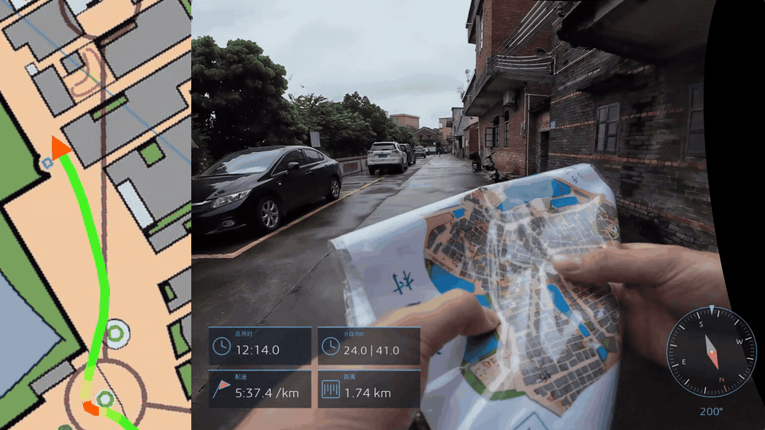
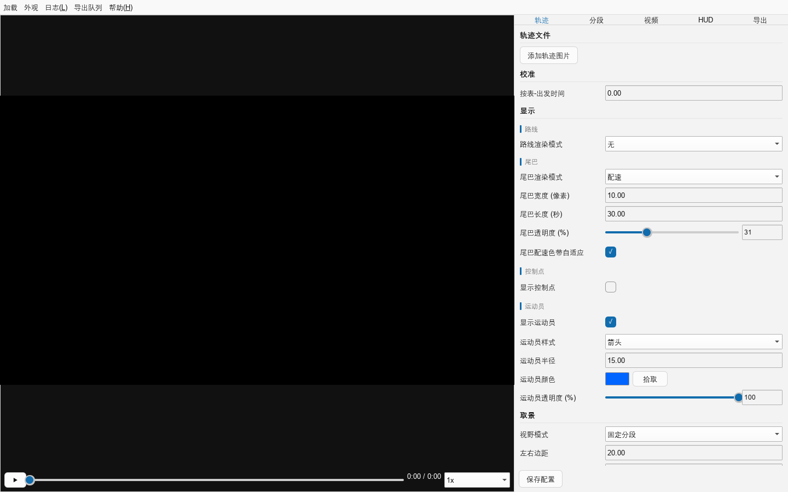

  

<h1 align="center">TraceReel · 迹映</h1>

  <strong>让路线成为影像。</strong>
   
  把定向越野实拍、地图轨迹与运动数据，合成一段完整的赛事回放。

  <a href="https://github.com/WaterFishJ/tracereel/releases">📦 下载 Windows 便携版</a> ·
  <a href="#-快速上手">🚀 快速上手</a> ·
  <a href="docs/开发与构建.md">🛠️ 开发与构建</a> ·
  <a href="https://github.com/WaterFishJ/tracereel/issues">💬 问题反馈</a>

---

**TraceReel 是一款面向定向越野的 Windows 视频制作与路线回放软件。** 导入运动相机视频、定向地图和 GPS 轨迹，在同一条时间轴上对齐画面、路线与分段成绩，再加入防抖和运动数据 HUD，导出可用于赛事分享、训练复盘的视频。

本项目以 Rust 重写 [OrientView](https://github.com/mikoro/orientview)，兼容 [QuickRoute](https://github.com/matstroeng/quickroute) 相关素材，并融合 Gyroflow 防抖与 FFmpeg 导出。

## 🎬 效果展示

### 导出视频

### 软件 GUI

*实际软件界面（空白工程）：在同一窗口中管理素材、预览画面、调整地图与防抖，并配置 HUD 和导出。*

## ✨ 核心功能

### 🌀 融合 Gyroflow，让防抖更方便

内置 **Gyroflow 防抖核心**，在 TraceReel 内完成防抖参数调整、预览和导出，简化素材处理流程。支持镜头标定与陀螺数据驱动的稳定化，多段视频导出时平滑处理防抖接缝。

> 陀螺防抖需要视频包含可用的陀螺 / IMU 数据，并使用匹配的镜头标定；相关说明见 [防抖预设与镜头标定](presets/README.md)。

### ⚡ FFmpeg 导出，编码选择更丰富

基于 **FFmpeg** 导出，支持 **H.264、HEVC / H.265、AV1** 编码，以及 QSV、NVENC、AMF 硬件编码与软件编码。可按设备和用途选择输出方案，利用硬件加速提升导出效率。

支持分段拼接、导出队列与日志；多段视频使用各自音轨，并在接缝处做音频交叉淡化。地图、视频与 HUD 可按需开关。

### 📊 自带 HUD，让运动数据进入画面

内置运动数据 HUD，可叠加**用时、分段、配速、距离、心率、海拔与指南针**等信息，并调整布局与样式。视频、地图和数据随时间同步，让观众更容易理解路线选择与比赛节奏。

### 📷 成绩单 OCR，减少手动录入

导入成绩单 / 成绩条照片，通过**本地 OCR** 识别分段成绩，核对后导入时间轴。支持分段用时与累计时间，省去逐项输入的繁琐操作。

### 🗺️ 地图与轨迹，围绕定向越野设计

| 能力 | 支持内容 |
|---|---|
| 地图与轨迹导入 | QuickRoute `.qrt`（内嵌地图、轨迹与分段）、QuickRoute 导出的 `.gpx.jpg`、GPX、普通图片底图 |
| 路线回放 | 分段取景、跟随点、轨迹尾迹、配速色带与控制点显示 |
| 多地图与分段 | 按时间切换地图；可直接导入 `.qrt` 中的分段时刻 |
| 时间轴与预览 | 拖动定位、可配置的键盘跳转；地图可平移、旋转与缩放 |
| 工程保存 | 使用 `.trr` 工程文件，也支持打开旧 `.orv` 工程 |

## 📦 下载与运行

目前支持 **Windows 10 / 11 x64**。

1. 前往 [Releases](https://github.com/WaterFishJ/tracereel/releases)，下载 `TraceReel-<版本>-windows-x64-<时间戳>-portable.zip`。
2. **完整解压**到一个普通文件夹。
3. 双击 `TraceReel.exe`，即可使用，无需另行安装 Rust、Qt 或 FFmpeg。

ZIP 旁的 `.sha256` 文件可用于校验下载。硬件编码需要相应显卡驱动；不可用时会回退软件编码。

## 🚀 快速上手

1. **导入素材**：添加实拍视频、定向地图与轨迹；已有 QuickRoute 工程时，可直接导入 `.qrt`。
2. **对齐时间**：同步视频与路线，导入分段成绩；成绩条照片可用 OCR 识别，核对后导入。
3. **调整画面**：设置地图取景、轨迹样式和 HUD；有陀螺数据的素材可配置 Gyroflow 防抖。
4. **预览并导出**：检查同步与布局，选择编码和输出参数，加入导出队列。

用户预设、HUD 模板与导出队列保存在 `%APPDATA%\TraceReel`。首次运行时会迁移旧 `OrientView` 用户数据，保留原文件且不覆盖已有 TraceReel 文件。

## ❓ 常见问题

**为什么显示“无运动数据”？**

该视频没有可用的陀螺 / IMU 数据，无法进行陀螺防抖。请检查相机录制设置及素材是否保留了运动数据。

**导入轨迹后，地图为什么不能正确取景？**

请确认地图与轨迹来自同一个 `.qrt`。只有经纬度、没有地图配准信息时，无法直接完成对应的地图取景。

**OCR 结果不准确怎么办？**

使用清晰的成绩条照片，框选成绩表并调整旋转方向；导入前核对识别结果。

**Windows 提示“未知发布者”？**

便携包尚未进行代码签名。请从本仓库 Releases 下载，并使用附带的 SHA256 校验文件检查完整性。

**想从源码构建或参与开发？**

依赖、环境变量、构建、打包、仓库结构与测试命令统一收录在 [开发与构建](docs/开发与构建.md)。另见 [贡献指南](CONTRIBUTING.md)、[更新记录](CHANGELOG.md) 与 [技术文档](docs/README.md)。

## 🤖 AI 开发说明

**本项目全程由 AI 完成，使用 DeepSeek 与 OpenAI。** 感谢 AI 工具，也感谢为本项目提供基础的开源社区。

## 🤝 致谢与许可

感谢以下开源项目及其作者：

| 项目 | 对 TraceReel 的贡献 |
|---|---|
| [OrientView](https://github.com/mikoro/orientview) | 原始程序，以及界面、交互与地图 / 轨迹渲染设计 |
| [QuickRoute](https://github.com/matstroeng/quickroute) | `.qrt` 工程格式、轨迹 / 分段语义与配速色带算法 |
| [Gyroflow](https://github.com/gyroflow/gyroflow) · [镜头标定库](https://github.com/gyroflow/lens_profiles) | 陀螺防抖核心与相机镜头标定数据 |
| [FFmpeg](https://github.com/FFmpeg/FFmpeg) | 视频解码与导出编码 |
| [Qt](https://github.com/qt) | 桌面 GUI 与图形渲染基础 |
| [ONNX Runtime](https://github.com/microsoft/onnxruntime) | 本地 OCR 推理运行时 |
| [PaddleOCR](https://github.com/PaddlePaddle/PaddleOCR) · [RapidOCR](https://github.com/RapidAI/RapidOCR) | OCR 模型与模型分发 |

TraceReel 以 **GPL-3.0-or-later** 发布，见 [LICENSE](LICENSE)。第三方组件、来源与分发要求见 [THIRD-PARTY.md](THIRD-PARTY.md)。分发二进制时，请一并提供完整对应源码，包括主仓库同一标签及 `gyroflow-src` 子模块对应提交。

## 💬 联系作者

**微信：13302831843**

欢迎交流定向越野视频制作、反馈使用体验或提出改进建议。软件问题也可提交到 [GitHub Issues](https://github.com/WaterFishJ/tracereel/issues)。
